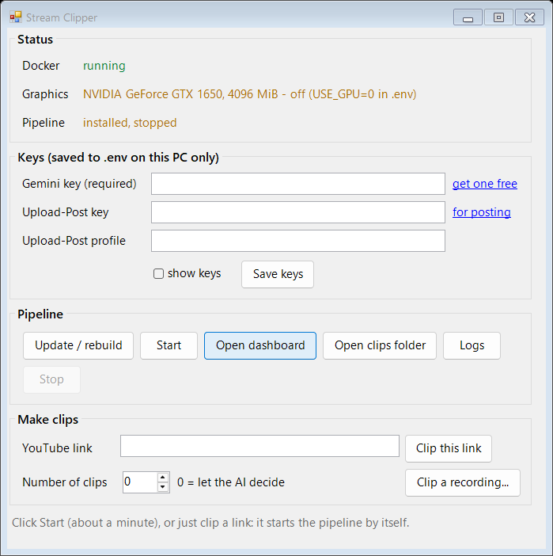

# stream-clipper

Turn a YouTube live stream into ready-to-post vertical shorts, on your own
machine, with no watermark.

It is [OpenShorts](https://github.com/mutonby/openshorts) (MIT), pinned to a
tested commit, plus one addition: **YouTube moment signals**. OpenShorts already
uses what Twitch viewers clipped to find good moments, but YouTube has no clips
API, so this adds the signals a YouTube stream does have (see
[How moments are found](#how-moments-are-found)).

```
YouTube VOD link ─┐                                   ┌─ clips/<date>_<title>/00_….mp4
                  ├─ download ─ transcribe ─ signals ─ pick ─ reframe 9:16 ─ captions ─┤
OBS recording ────┘   (yt-dlp)   (Whisper)    (chat,    (Gemini) (gameplay +            └─ dashboard → post to
                                              replays,           facecam)                  TikTok / Shorts / Reels
                                              loudness,
                                              markers)
```

## Quick start (Windows, point and click)

You need **Docker Desktop** ([download](https://docs.docker.com/desktop/setup/install/windows-install/))
and **git** (`winget install Git.Git`).

```powershell
git clone https://github.com/elyashium/stream-clipper.git
```

Then open the `stream-clipper` folder and double-click **`Stream Clipper.cmd`**:



1. Paste the **Gemini key** ([free](https://aistudio.google.com/app/apikey)) and click **Save keys**.
2. Click **Install** once. A console window shows the build (several GB, 10–30
   minutes the first time). An NVIDIA card is detected and used automatically.
3. Paste the stream's YouTube link and click **Clip this link**, or **Clip a
   recording...** for an OBS file. A console window follows the job and lists
   the clips when it ends.
4. **Open clips folder** for the files, or **Open dashboard** to trim, re-caption
   and post them.

Status is live in the window (Docker, GPU, pipeline). If Docker Desktop isn't
running, the buttons start it.

## Command line (Windows, macOS, Linux)

Same thing without the window:

```powershell
cd stream-clipper
.\clipper.ps1 setup          # macOS/Linux: ./clipper.sh setup
```

`setup` downloads OpenShorts, applies the patch and builds everything. It also
creates `.env` (with `USE_GPU=1` if it finds an NVIDIA card). Open it
(`notepad .env`) and paste your key:

| Key | Needed? | Where |
|---|---|---|
| `GEMINI_API_KEY` | **yes** | free at <https://aistudio.google.com/app/apikey> |
| `UPLOAD_POST_API_KEY` + `UPLOAD_POST_USER` | only for posting | free plan (10 uploads/month) at <https://www.upload-post.com>; connect TikTok/YouTube/Instagram there, `UPLOAD_POST_USER` is that profile's name |
| `USE_GPU=1` | set by itself when an NVIDIA card is found | change it, then run `setup` again to rebuild |

Then clip a stream:

```powershell
.\clipper.ps1 run "https://www.youtube.com/watch?v=VIDEO_ID"
# or a local OBS recording:
.\clipper.ps1 run .\recordings\2026-11-19_gta6.mp4
```

It prints the pipeline log as it goes and ends with a list of clips, saved to
`clips\<date>_<title>_<job>\` along with a `clips.txt` of titles and captions.
Review them in the dashboard at <http://localhost:5175/#app> (edit cuts,
captions, layout) and post from there. Your keys from `.env` are already filled
in there. Jobs started in the dashboard get copied to `clips\` by
`.\clipper.ps1 sync` (the window's **Open clips folder** does it for you). Or
post from the command line:

```powershell
.\clipper.ps1 post <job_id> 0 --platforms tiktok,youtube,instagram
.\clipper.ps1 post <job_id> 1 --platforms tiktok --schedule 2026-11-20T18:00:00
```

> **"running scripts is disabled on this system"?** Run this once:
> `Set-ExecutionPolicy -Scope CurrentUser RemoteSigned`. Or use `.\clipper.cmd`
> instead of `.\clipper.ps1`. It takes the same commands.

### All commands

| | |
|---|---|
| `gui` | the window (same as `Stream Clipper.cmd`) |
| `setup` | first install, and after changing `USE_GPU` |
| `start` / `stop` | start or stop the pipeline + dashboard |
| `open` | open the dashboard |
| `run <url\|file> [--clips N] [--min S] [--max S]` | clip a stream |
| `post <job> <n> [--platforms …] [--schedule ISO]` | post clip `n` of a job |
| `jobs` | list clip folders |
| `sync` | copy clips of dashboard jobs into `clips/` |
| `logs` | follow the backend log |
| `update` | pull this repo and rebuild |
| `doctor` | check Docker, GPU, keys |

## Set up OBS once (5 minutes, worth it)

1. **Record while you stream.** Settings → Output → Recording:
   - **Recording path** → this repo's `recordings` folder. Then `run` reads the file
     directly with no copying.
   - **Recording format** → **Hybrid MP4** (OBS 30.2+). Needed for markers, and a
     crash doesn't corrupt the file.
2. **Bind the clip hotkey.** Settings → Hotkeys → **Add Chapter Marker**, for example
   `F9`. Press it right after anything good happens. Each press is the strongest
   signal the picker gets, and the clip reaches back about 35 s before the press.
3. **Put the mic on its own audio track** (optional, helps the loudness signal).
   In Output → Recording, tick tracks 1 and 2. In Edit → Advanced Audio
   Properties, put the mic on 1 and 2 and the game only on 1. Then set
   `MIC_AUDIO_TRACK=1` in `.env`.
4. **Turn the in-game radio down or off.** Licensed music in clips is the
   number-one cause of copyright claims and muted audio on Shorts, TikTok and
   Reels.

**VOD link or local recording?**

| | YouTube VOD link | local OBS recording |
|---|---|---|
| chat-replay spikes | ✅ | — |
| "Most replayed" | ✅ (after a few days of views) | — |
| mic loudness spikes | ✅ (mixed audio) | ✅ (clean mic track) |
| hotkey markers | — | ✅ |
| quality | YouTube's re-encode | original |

Use the link if chat was active. Use the recording if you pressed the hotkey
during the stream. YouTube doesn't keep archives of streams longer than 12
hours, so for marathon streams use the recording.

## How moments are found

Picking clips from the transcript alone misses most gaming highlights. A crash
or a chase is often a scream and ten seconds of nobody talking. OpenShorts
handles Twitch by asking which stretches viewers clipped. For YouTube,
[`stack/overlay/youtube_signals.py`](stack/overlay/youtube_signals.py) collects
four cheap signals and passes them through the same path:

| Signal | How | Cost |
|---|---|---|
| **Chat spikes** | yt-dlp downloads the live-chat replay. Messages are counted per 5 s against a rolling 10-minute baseline. Hype messages (`LMAO`, `W`, `CLIP IT`, 💀😂) count double and Super Chats count 4×. Each spike is shifted back 12 s, because chat reacts after the moment. | free, a few minutes on long streams |
| **Most replayed** | the "Most replayed" graph YouTube shows on the timeline (yt-dlp `heatmap`). Empty until the VOD has some views. | free |
| **Loudness spikes** | 1-second loudness of the mic track against a rolling 5-minute median. A jump of 9 dB or more is a scream or a laugh. | ffmpeg reads the audio once |
| **Hotkey markers** | OBS chapter markers in the recording | free |

These run in the background during the download. The pipeline then:

1. Shows them to Gemini alongside the transcript for every ~90 s window.
2. Guarantees the hottest windows a place on the shortlist, even if the
   transcript scores them low.
3. Has Gemini set the exact cut points, captions and titles.

So the LLM still makes the final call, but it can't miss the moments chat went
off on. Every signal is best effort: if chat replay is off or yt-dlp fails, the
job carries on with the others.

Tuning knobs live in `.env` (`CHAT_DELAY_SECONDS`, `MIC_AUDIO_TRACK`,
`LOUDNESS_SIGNAL`, `YOUTUBE_SIGNALS=0` to turn all of it off).

## Speed

With an NVIDIA card (`USE_GPU=1`, set automatically) everything heavy runs on
it:

- **Transcription**: NVIDIA Parakeet on CUDA (falls back to Whisper
  large-v3-turbo for languages outside its 25 European ones), `int8_float16` so
  it fits a 4 GB card like a GTX 1650.
- **Decoding, reframing, captions**: NVDEC decode plus OpenShorts' one-pass GPU
  renderer, then **NVENC** encoding.
- **One job at a time** gets the whole card; a second one queues.

Other things that keep it quick:

- The dashboard is a static production build behind nginx, not a dev server.
- Video I/O and model weights live in Docker volumes, not on a slow Windows
  folder mount. Models download once and survive rebuilds.
- Local recordings in `recordings/` are read in place, never copied.
- Chat replay and "Most replayed" download in parallel with the video.

On CPU only, expect about 1 minute of processing per minute of video. Leave it
running overnight.

## Troubleshooting

- **`run` says the API isn't answering**: run `start`, wait for "ready", then
  check `logs`.
- **YouTube: "Sign in to confirm you're not a bot"**: put cookies from a
  **throwaway** account into `YOUTUBE_COOKIES` in `.env`, or use the local
  recording instead.
- **`setup` says the patch no longer applies**: only possible if
  `stack/UPSTREAM_SHA` was changed. Revert it, or regenerate the patch (see below).
- **Out of disk**: the pipeline's working files are in Docker volumes.
  `.\clipper.ps1 stop`, then `docker volume rm clipper_clipper_output
  clipper_clipper_uploads` frees them (your copies in `clips/` are separate;
  run `sync` first). Keep `clipper_clipper_models`, or the models download again.
- **Install fails with "being used by another process"**: antivirus holding a
  Docker temp file. `setup` already retries once; click Install again if it
  still fails. Everything built so far is cached.
- **GPU not used**: `.\clipper.ps1 doctor` shows the card and `USE_GPU`. Docker
  Desktop needs the WSL 2 backend (the default) and a current NVIDIA driver.

## How this repo is built

```
Stream Clipper.cmd                        double-click: opens the window (stack/gui.ps1)
clipper.ps1 / clipper.sh / clipper.cmd   the one command
stack/UPSTREAM_SHA                        OpenShorts commit we pin and test against
stack/patches/openshorts.patch            signals hook in main.py, upload size + keys-from-.env in app.py and the dashboard
stack/overlay/youtube_signals.py          the YouTube signals (copied into openshorts/)
stack/gui.ps1                             the Windows Forms window
stack/run_job.py                          submits a job and collects the clips (runs inside the container)
stack/docker-compose.override.yml         .env, folders, volumes, prod dashboard, localhost-only ports
stack/nginx.conf                          serves the dashboard and proxies the API
stack/docker-compose.gpu.yml              NVIDIA build + runtime, used when USE_GPU=1
stack/env.template                        becomes .env
tests/                                    python -m unittest discover -s tests
```

`openshorts/` is fetched by `setup` and git-ignored. To move to a newer
OpenShorts: put the new commit in `stack/UPSTREAM_SHA`, run `setup`, fix the
patch if it fails, and regenerate it with
`git -C openshorts diff -- main.py app.py dashboard/src > stack/patches/openshorts.patch`.

**Keys in the dashboard.** The dashboard normally asks for keys and keeps them
in the browser. Here `/api/config` hands it the keys from `.env` instead, but
only with `CLIPPER_LOCAL_KEYS=1`, only to same-origin requests from
`localhost`, and every port is bound to `127.0.0.1`, so nothing else on the
network can reach them.

OpenShorts is MIT-licensed, © OpenShorts. Its `cloud/` folder is under a
separate commercial license and isn't used here: self-hosted mode never turns it
on, and there is no watermark.
